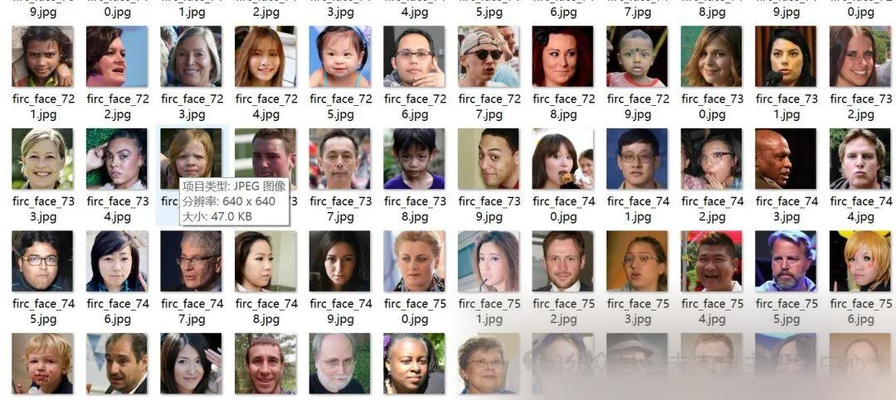
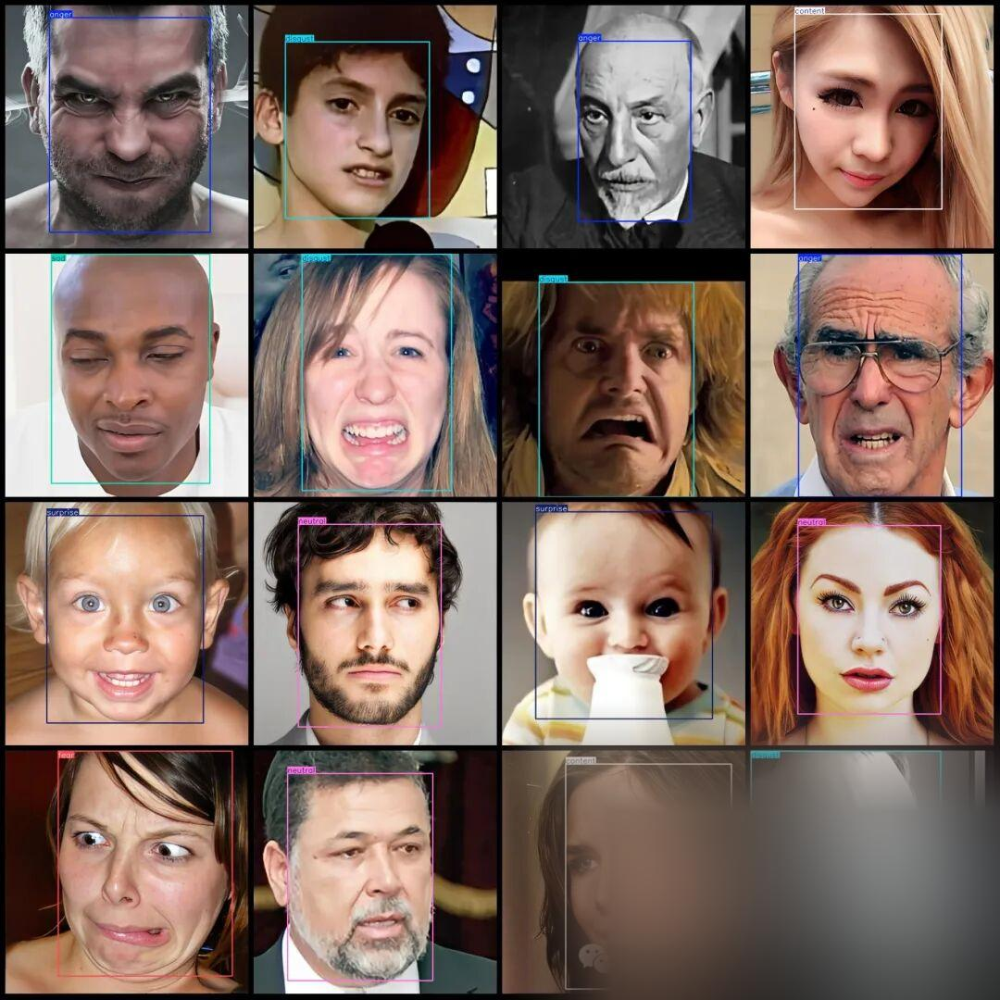

# VOC+YOLO format: 9400 face expression recognition detection dataset with 8 categories

Dataset format: Pascal VOC format + YOLO format (txt file without split path, only containing jpg images and corresponding VOC format xml files and yolo format txt files)

Number of images (number of jpg files): 9400

Number of annotations (number of xml files): 9400

Number of annotations (number of txt files): 9400

Annotation Category Count: 8

Label category names (note that the order of categories in the YOLO format does not correspond to this, but is based on the labels folder's classes.txt): ["anger", "content", "disgust", "fear", "happy", "neutral", "sad", "surprise"]

Number of boxes labeled in each category:

anger Frames = 1191

Content Frame Count = 1149

Disgust Frames = 1172

Fear Frames = 1184

Happy Frames = 1173

Neutral Frame Count = 1232

sad box count = 1192

Surprise Frames = 1245

Total frame count: 9538

Using labelImg:

Annotation rules: Draw a rectangle around the category.

Important Notice: No

Special : This dataset does not guarantee the accuracy or precision of the trained models or weight files. The dataset is provided with accurate and reasonable annotations only.

Image Preview:

Annotation example:

## Payment

Here is a pay link on Stripe ( https://buy.stripe.com/3cs8yP7sY87d0vu9AB ). Please contact me lonlonago@foxmail.com after funding $89, and I will send you a complete data files , thank you!

